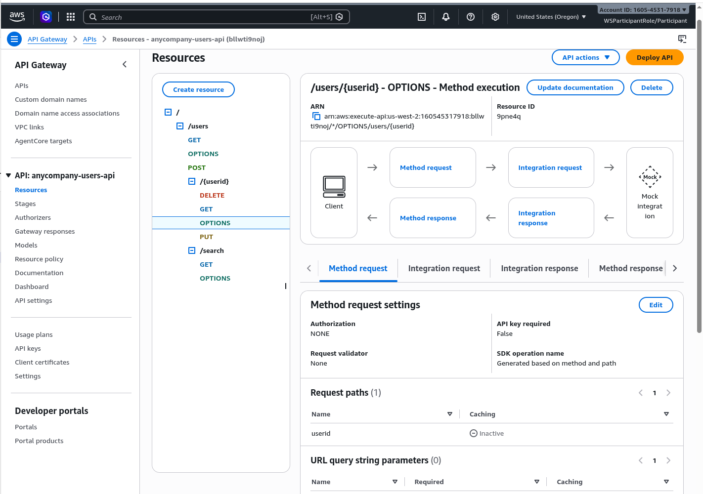
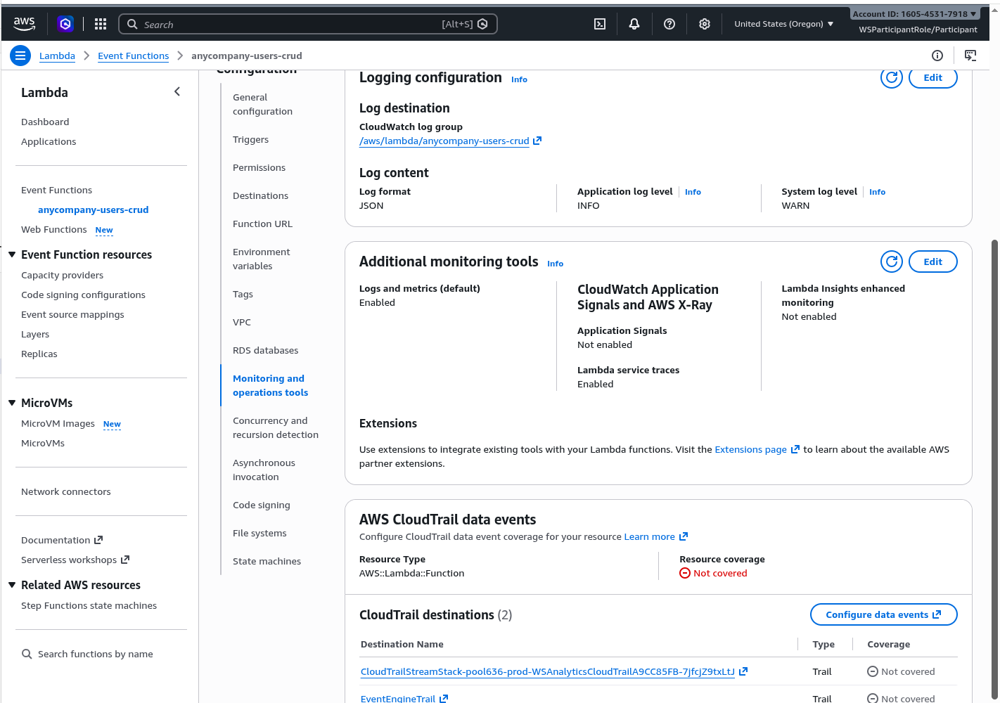
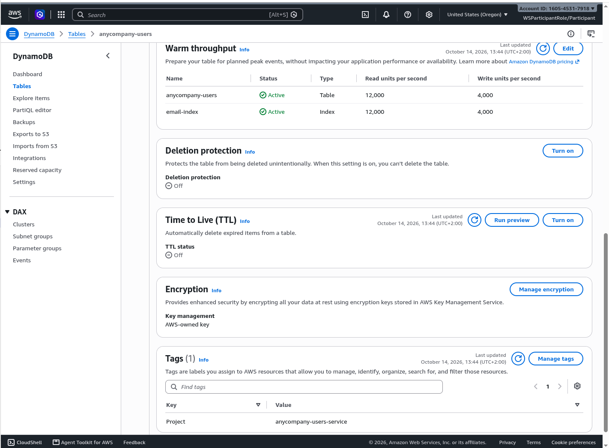
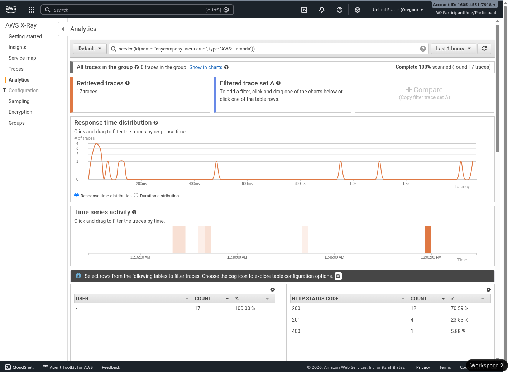

# Screenshots

The running service, captured in the AWS console and the demo client shortly before the
deployment was destroyed. This page only shows the pictures. What each one proves, and what it
does not, is in the caption under the same heading in the [walkthrough](../walkthrough.md#screenshots);
how they were taken is in [`screenshot-process.md`](../screenshot-process.md).

The captions live in one place on purpose, so that a correction cannot reach one copy and miss
the other.

## 01 — API Gateway → Resources

[Caption in the walkthrough](../walkthrough.md#01--api-gateway--resources)

## 02 — API Gateway → Stages → prod

[Caption in the walkthrough](../walkthrough.md#02--api-gateway--stages--prod)

## 03 — Lambda → anycompany-users-crud → Configuration

[Caption in the walkthrough](../walkthrough.md#03--lambda--anycompany-users-crud--configuration)

## 04 — DynamoDB → table → Indexes

[Caption in the walkthrough](../walkthrough.md#04--dynamodb--table--indexes)

## 05 — DynamoDB → Item explorer

[Caption in the walkthrough](../walkthrough.md#05--dynamodb--item-explorer)

## 06 — Cognito → user pool → Users

[Caption in the walkthrough](../walkthrough.md#06--cognito--user-pool--users)

## 07 — CloudWatch Logs, entries expanded

[Caption in the walkthrough](../walkthrough.md#07--cloudwatch-logs-entries-expanded)

## 08 — CloudWatch → Application Signals → Trace Map

[Caption in the walkthrough](../walkthrough.md#08--cloudwatch--application-signals--trace-map)

## 09 — The demo client, logged in

[Caption in the walkthrough](../walkthrough.md#09--the-demo-client-logged-in)

## 10 — The demo client, rejected

[Caption in the walkthrough](../walkthrough.md#10--the-demo-client-rejected)

## 11 — The demo client next to `.env.test`

[Caption in the walkthrough](../walkthrough.md#11--the-demo-client-next-to-envtest)

## 12 — API Gateway → Resources → `OPTIONS /users/{userid}`

[Caption in the walkthrough](../walkthrough.md#12--api-gateway--resources--options-usersuserid)

## 13 — Lambda → anycompany-users-crud → Monitoring and operations tools

[Caption in the walkthrough](../walkthrough.md#13--lambda--anycompany-users-crud--monitoring-and-operations-tools)

## 14 — DynamoDB → table → Settings

[Caption in the walkthrough](../walkthrough.md#14--dynamodb--table--settings)

## 15 — X-Ray → Analytics, filtered to the CRUD function

[Caption in the walkthrough](../walkthrough.md#15--x-ray--analytics-filtered-to-the-crud-function)
