# Walkthrough

This repository is a learning artefact. It was built in an AWS workshop to practise two things
at once — Terraform against real AWS services, and spec-driven development — and the deployment
it describes has been destroyed. Nothing here ever served a real user, and it is not meant to.

That shapes what this page is for. The code and the specs say *what* was built; this page says
what it looked like while it ran, and — more usefully — what went wrong on the way and how each
problem was found. The failures are the part that is hardest to reconstruct from a finished
repository, and the part most worth reading.

- [Before you take screenshots](#before-you-take-screenshots)
- [What was built](#what-was-built)
- [Screenshots](#screenshots)
- [Running the demo client](#running-the-demo-client)
- [What went wrong, and why](#what-went-wrong-and-why)
- [How I fooled myself](#how-i-fooled-myself)
- [Deliberately not published](#deliberately-not-published)

## Before you take screenshots

Three things end up in pictures without anyone deciding to put them there:

- **The AWS account id**, in almost every console ARN and in the breadcrumb of several pages.
- **The API id**, which is also the public hostname of the invoke URL.
- **An access token**, if the browser's developer tools are open on the Network tab. A bearer
  token in a screenshot in a public repository is a real credential until it expires.

For a destroyed workshop account none of this matters much. For anything you intend to keep
running, crop or redact before committing.

## What was built

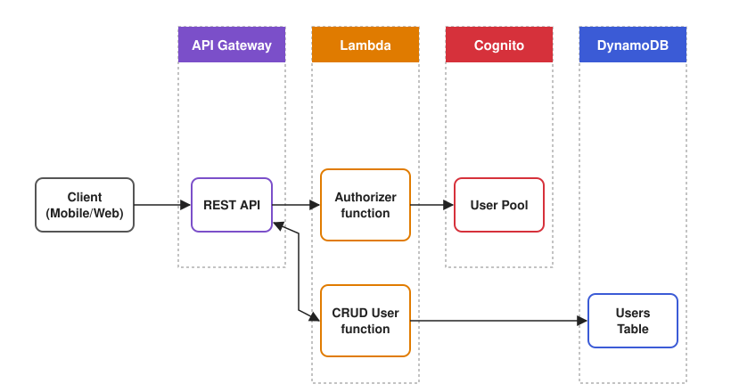

*Drawn for this repository after the topology in the workshop documentation, rather than copied
from it, so that the picture can be published under the same licence as everything else here.*

Six HTTP methods in front of one DynamoDB table, with every request authorized by a Lambda that
validates Cognito access tokens. The links below are templates: fill in your own ids with

```bash
cd infrastructure
terraform output
```

| Component | Console page | What it shows |
|---|---|---|
| REST API | `apigateway/main/apis/<api-id>/resources` | the resource tree, each method's authorizer, and `OPTIONS` as `NONE` |
| Stage | `apigateway/main/apis/<api-id>/stages/prod` | X-Ray tracing on, access logs pointed at a log group |
| CRUD function | `lambda/home#/functions/anycompany-users-crud` | `python3.13` on `arm64`, JSON log format, active tracing |
| Authorizer | `lambda/home#/functions/anycompany-users-authorizer` | the same, plus its `build/` package with PyJWT |
| Table | `dynamodbv2/home#table?name=anycompany-users` | on-demand billing, and the `email-index` GSI under *Indexes* |
| Items | `dynamodbv2/home#item-explorer?table=anycompany-users` | records with exactly five attributes |
| User pool | `cognito/v2/idp/user-pools/<pool-id>/users` | the test user, email as the username |
| Logs | `cloudwatch/home#logsV2:log-group/...anycompany-users-crud` | one JSON record per request, with `route` and `api_request_id` |
| Traces | CloudWatch → Application Signals → *Trace Map* | client → API Gateway stage → Lambda, with timings |

All of it is one `terraform apply` from `infrastructure/`, and one `terraform destroy` away from
gone.

## Screenshots

All ten planned screenshots exist, taken in the console and the demo client shortly before the
teardown, plus one that was not planned. Until they did, this section was a table of expected
filenames, because an `` pointing at a file that is not in the repository renders as a
broken image on GitHub.

Each caption describes what the frame actually shows, not what the capture plan hoped it would.
Where the two differ — 01, 03, and 10 — the caption says less, and says so: a caption that
claims more than its picture is a small version of the check that can only pass.

[`screenshot-process.md`](screenshot-process.md) records how they were produced — which pieces
the agent in the workshop environment could do, which needed a human with a browser, and the
prompts that handed the mechanical half over.

**01 — API Gateway → Resources**

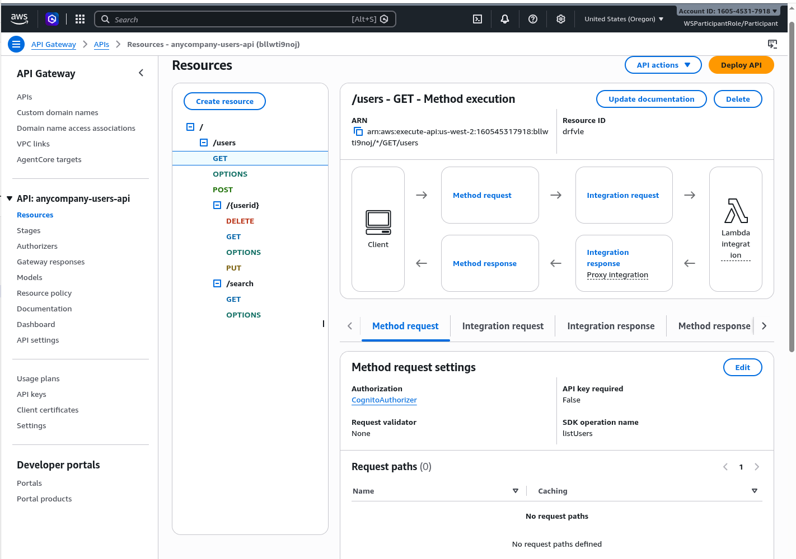

The resource tree with all six data methods and the three `OPTIONS` methods. The selected
`GET /users` is authorized by `CognitoAuthorizer`; the frame does not show the other five
methods' authorizers, or that `OPTIONS` has none.

**02 — API Gateway → Stages → prod**

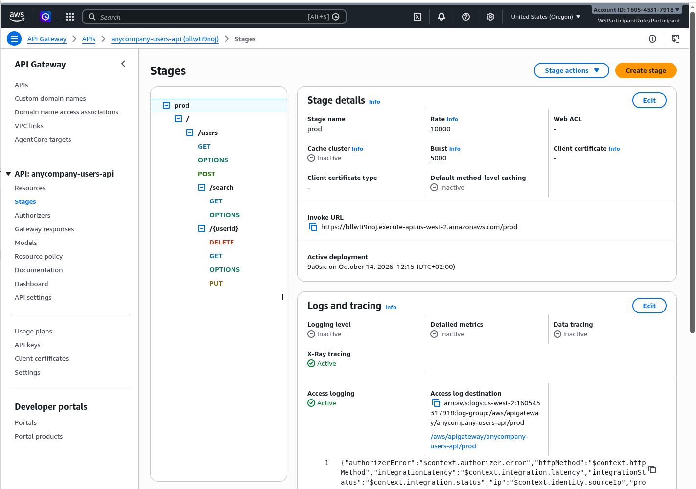

The deployed `prod` stage with X-Ray tracing active and access logging active, writing to the
API's own log group.

**03 — Lambda → anycompany-users-crud → Configuration**

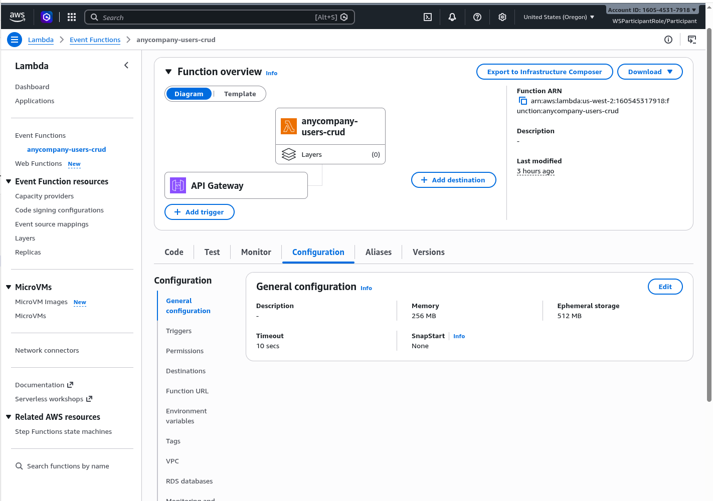

256 MB of memory and a 10 s timeout, the defaults in
[`infrastructure/variables.tf`](../infrastructure/variables.tf). Runtime and architecture are on
a different page and not in this frame.

**04 — DynamoDB → table → Indexes**

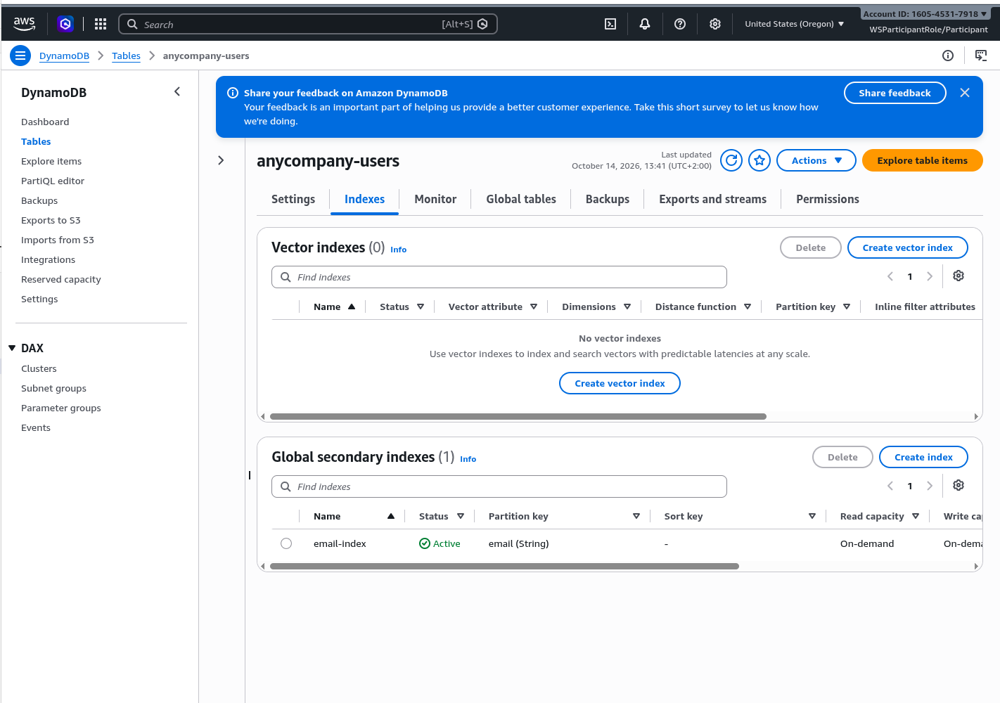

The `email-index` GSI with status `Active` and `email` as its partition key.

**05 — DynamoDB → Item explorer**

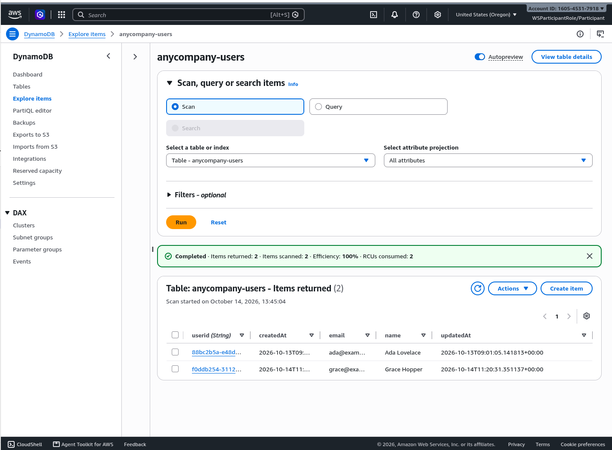

Two stored records, each with the five attributes `userid`, `createdAt`, `email`, `name`, and
`updatedAt`.

**06 — Cognito → user pool → Users**

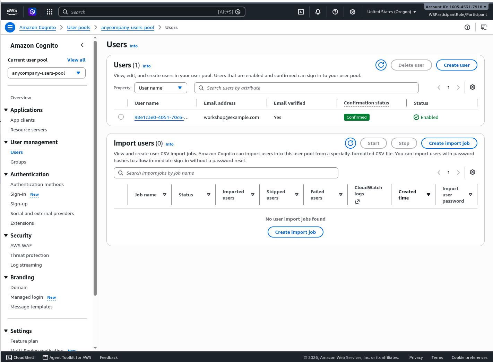

The test user, email verified, confirmed, and enabled.

**07 — CloudWatch Logs, entries expanded**

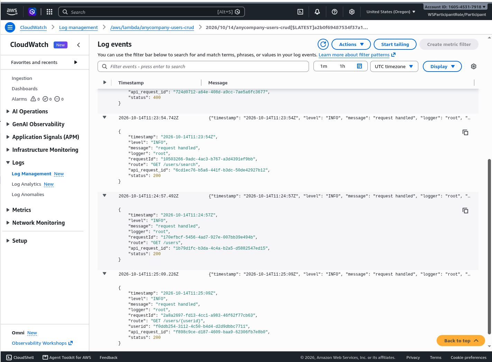

JSON log records with `route`, `status`, and `api_request_id` as separate fields, and no event
dump or token in any of the entries shown.

**08 — CloudWatch → Application Signals → Trace Map**

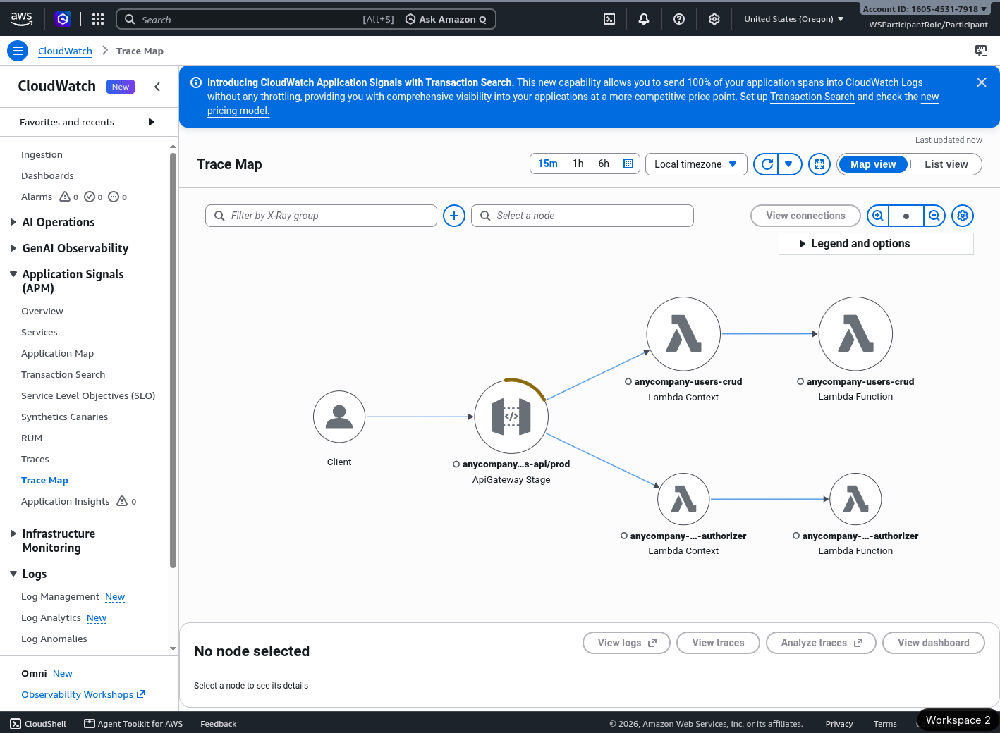

The request traced from the client through the API Gateway stage into the authorizer and the
CRUD function. There is no DynamoDB node; [see below](#what-went-wrong-and-why) for why.

**09 — The demo client, logged in**

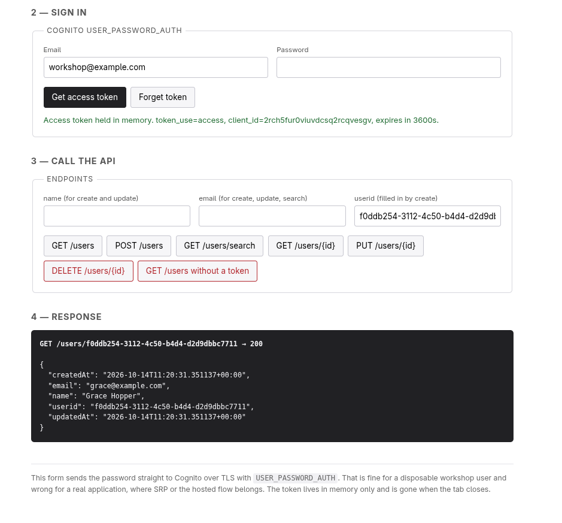

Signed in, with only the token's non-secret claims shown, and `GET /users/{id}` answering `200`
with a real record.

**10 — The demo client, rejected**

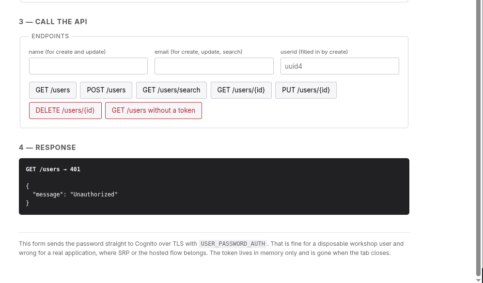

`GET /users` answered `401 Unauthorized`. The frame shows the response, not the request, so it
does not itself prove that no token was sent; the button that sends none is described
[below](#running-the-demo-client).

**11 — The demo client next to `.env.test`**

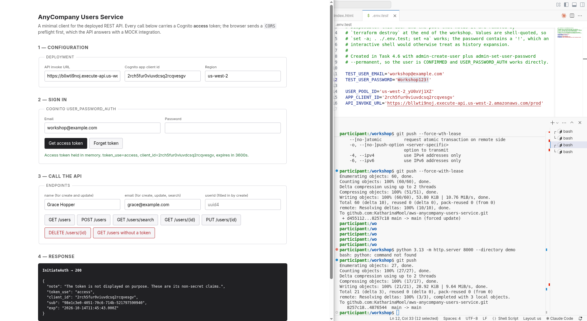

Not part of the plan, and published on purpose. The right half shows `.env.test` with the test
user's password in plain text, which breaks the capture rule in
[`screenshot-process.md`](screenshot-process.md#capture-rules). It is here because the user pool
is destroyed with the stack, so the password opens nothing, and the frame shows what the others
cannot: the page signed in as the user whose configuration is open beside it. The session transcript stays
unpublished all the same, for the reason given [at the end](#deliberately-not-published): it
also holds temporary AWS credentials, which this picture does not. The file itself is still
gitignored and not committed.

## Running the demo client

[`demo/index.html`](../demo/index.html) is one file with no dependencies and nothing
account-specific in it. From the repository root:

```bash
python3.13 -m http.server 8000 --directory demo
```

Then open `http://localhost:8000`, or prefill the configuration from the query string:

```
http://localhost:8000/?api=<invoke url>&client=<app client id>&region=<region>
```

Sign in with the user from `.env.test`. The client calls Cognito's `InitiateAuth` directly over
HTTPS — no AWS SDK, no client secret — and keeps the resulting **access** token in a single
JavaScript variable. It is never written to `localStorage`, `sessionStorage`, a cookie, the URL,
or the page, because this client exists to be photographed.

The last button sends `GET /users` with no `Authorization` header on purpose, so the `401` is
reproducible next to the working call.

## What went wrong, and why

Six findings, each one the kind of thing that is obvious afterwards.

**A GSI query is authorized on the index ARN, not the table ARN.** The function could already
read and write the table, so the IAM policy looked sufficient — and the search still failed with
`AccessDeniedException`. A global secondary index has its own ARN,
`<table-arn>/index/<index-name>`, and `dynamodb:Query` has to be granted on that. It needs its
own policy statement.

**`put_rest_api` runs in overwrite mode.** Importing a changed OpenAPI body replaces the entire
API definition and silently discards anything that is not in the imported document — including
gateway responses declared as separate Terraform resources. This broke CORS on error responses
on the live API for a while, and it was my own regression: the verification step after that
change printed status codes but not headers, so nothing noticed. The fix was structural rather
than careful: the gateway responses now live *inside* the body, where an overwrite cannot lose
them.

**A REST API stage cannot write access logs** until the account's API Gateway settings carry a
CloudWatch Logs role. Without `aws_api_gateway_account`, the apply fails outright. It is
account- and region-wide singleton state, not per-stack, so in a shared account the last apply
wins — and destroying this stack removes the role for every other REST API in the region.

**The authorizer must return a stage-wide policy.** API Gateway caches an authorizer result for
`authorizerResultTtlInSeconds` and replays it across routes, so a policy naming a single method
denies every other method for the next five minutes. Returning
`arn:…:<api-id>/<stage>/*/*` is what makes the cache correct — and it is why adding the search
route and the preflight needed no authorizer change at all.

**PyJWT had to be pinned to 2.15.1, not just 2.x.** In 2.10.1, `PyJWKClient.get_jwk_set()` reads
its cache but never populates it, so the authorizer refetched the JWKS from Cognito on every
single invocation instead of once per cold start. A unit test that counts fetches found it; no
functional test would have, because the behaviour was correct and merely slow and chatty. That
test now pins the behaviour down.

**No `OPTIONS` method means no browser can call the API.** Every endpoint requires an
`Authorization` header, which makes a `fetch` non-simple, which makes the browser send a
preflight `OPTIONS` first — and the API answered `403 Missing Authentication Token` on all three
paths, because no such method existed. The CORS headers on the *responses* were correct the
whole time; the preflight was the missing half. The fix is a MOCK integration per path, and it
is the one method on this API deliberately deployed without an authorizer: a browser sends no
credentials on a preflight, so an authorizer there would make the API unreachable from the web
while looking perfectly secured. It reaches no backend, reads nothing, and returns `{}`.

**Active tracing does not trace the calls the function makes.** `tracing_config { mode =
"Active" }` on a Lambda function and `xray_tracing_enabled` on the stage produce a trace, but it
contains only what AWS records from the outside: the API Gateway stage, the Lambda service, the
function invocation, and an `Overhead` subsegment. The function's own `boto3` calls to DynamoDB
appear as subsegments only if the X-Ray SDK patches `boto3` inside the handler — `patch_all()`
from `aws-xray-sdk`, which is a dependency `src/users/` deliberately does not have, since the
MVP spec kept the CRUD function free of third-party packages. Verified by reading a trace
document directly: three segments, no `namespace: aws` subsegment for DynamoDB.

So the trace map shows a two-service path, not the three-tier picture the architecture diagram
suggests. The diagram is not wrong about the architecture; the trace is just a narrower
instrument than it looks. Closing the gap is one dependency and one `patch_all()` call, and it
would be the right change for a service anyone had to operate.

One more that is not a bug but costs time twice: **a new deployment takes a few seconds to
propagate.** Right after adding `/users/search`, a request to it returned
`404 {"message":"User not found"}` — it had fallen through to `/users/{userid}` with
`userid = "search"`. Right after adding the preflight, `OPTIONS` still returned `403`. Both were
correct a moment later. Literal path segments do beat path variables, and the preflight does
work; neither is true until the stage has caught up.

## How I fooled myself

Four times the measurement was wrong rather than the system, which is worth recording separately
because the failure mode is the same every time: a check that *can only pass*.

- **A CloudWatch filter pattern that matched a field name.** Scanning the access logs for leaked
  tokens, the pattern included `httpMethod` — a key present in every record — so all 75 records
  "matched" and it looked like a catastrophic leak. Re-scanning for `eyJ` and
  `authorizationToken` returned zero. The same trap appeared again at the end: a secret scan over
  the repository flagged three files, all of which contained the *string*
  `AWS_SECRET_ACCESS_KEY` as a variable name, a documented grep pattern, and a hand-made fake
  token.
- **A test harness that substituted a token into the "no token" case.** The end-to-end suite used
  `${4:-$TOK}`, which treats an explicitly empty argument as unset, so the check for
  "unauthenticated request is rejected" quietly sent a valid token and reported `200` as a pass.
  `${4-$TOK}` — without the colon — is the difference between a passing test and a test that can
  only pass. The committed [`scripts/e2e.sh`](../scripts/e2e.sh) carries a comment at that line.
- **`__pycache__` inside `src/`.** Running the tests changed the hash of the Lambda zip, so
  Terraform reported the function as needing redeployment every time. Fixed from both ends:
  `sys.dont_write_bytecode = True` in the test conftest, and `excludes = ["__pycache__"]` on the
  archive.
- **Counting tests two different ways.** An automated check claimed the README overstated the
  suite — "84 tests but there are only 52". Both numbers were right: 84 test *cases* collected,
  52 test *functions*, the difference being six `@pytest.mark.parametrize` decorators. Nothing
  was wrong except the wording, so the wording changed and no number did.

## Deliberately not published

Two artefacts were kept out of this repository on purpose.

**The Terraform state** (`infrastructure/terraform.tfstate`) is gitignored. It is the only file
in the project that cannot be regenerated — it is the mapping from configuration to real
resources — but publishing state is a habit worth not acquiring: state files routinely contain
values that were never meant to be read, and this one carries the account id and every resource
identifier. With the deployment destroyed, it has no remaining use.

**The session transcript.** The entire build was driven through Claude Code, and the transcript
is the richest record of the process — far more detailed than these specs. It is not here,
because it also contains temporary AWS credentials pasted into the session and the test user's
password. Publishing it would mean scrubbing it first, line by line, and a scrubbed transcript
is easy to get wrong in a way nobody notices.

What *is* here, and is often left out: the three spec sets in [`specs/`](../specs/), the project
conventions in [`AGENTS.md`](../AGENTS.md) that every decision was measured against, the
end-to-end suite in [`scripts/`](../scripts/), and the Claude Code configuration in `.claude/` —
the hook and the skill that ran during the build.
